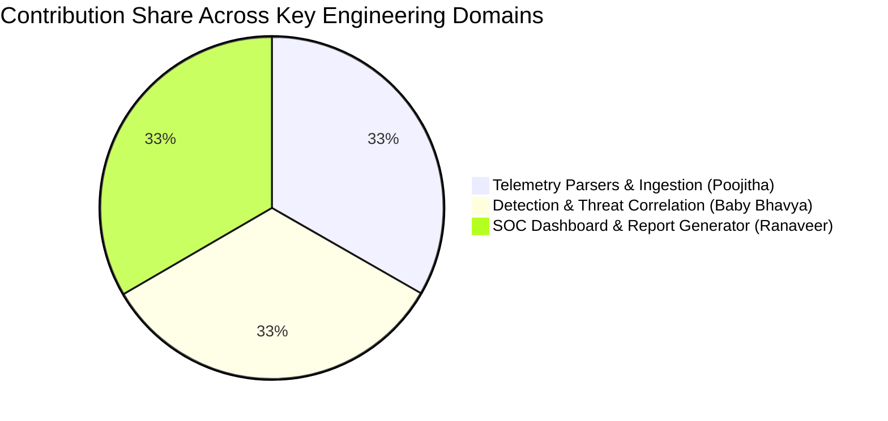

# 👥 Academic Project Contributions & Module Ownership

This document details the division of engineering responsibilities, technical deliverables, and module ownership for the **CYBER-SHIELD** group internship project, submitted in partial fulfillment of the academic requirements for the award of Bachelor of Technology in Computer Science and Engineering (Cyber Security) at **Sreenidhi Institute of Science and Technology (SNIST)**.

---

## 📋 Team Composition & Roll Number Sequence

In accordance with academic protocol and official university evaluation records, team members are sequenced in ascending order of roll numbers:

1. **24311A6201** – **POOJITHA BURRI**
2. **24311A6203** – **BABY BHAVYA SRI CHOWDARY**
3. **24311A6211** – **ALLE RANAVEER**

---

## 🏆 Detailed Responsibility & Module Ownership Matrix

| Candidate | Academic Roll No. | Subsystem & Module Ownership | Key Technical Deliverables | Code & Asset Areas |
|:---|:---:|:---|:---|:---|
| **Poojitha Burri** | `24311A6201` | **Ingestion Subsystem & Log Normalization** | • Engineering format-agnostic `BaseParser` interface • Authoring regex parsers for Apache access logs, Linux `auth.log` • Implementing Windows Security CSV (4624/4625) & Palo Alto firewall parsers • Designing the dual-storage forensic archive (`data/raw/`) • Designing SQLite schema and Write-Ahead Logging (WAL) configuration | • `parsers/base.py` • `parsers/apache_parser.py` • `parsers/linux_parser.py` • `parsers/windows_parser.py` • `parsers/paloalto_parser.py` • `database.py` • `tests/test_parsers.py` |
| **Baby Bhavya Sri Chowdary** | `24311A6203` | **Sliding-Window Threat Detection & Correlation** | • Designing the stateful sliding-window temporal evaluation engine • Authoring declarative YAML detection rules (`rules.yaml`) • Establishing detection thresholds (SSH brute force, web scanning, firewall bursts) • Constructing cross-source IP correlation algorithms (`correlator.py`) • Developing automated synthetic threat test cases in Pytest | • `detector.py` • `correlator.py` • `config/rules.yaml` • `tests/test_detection.py` • `data/samples/` |
| **Alle Ranaveer** | `24311A6211` | **SOC Operations Console & Report Automation** | • Architecting the dark-mode React 18/19 SOC dashboard SPA • Developing interactive Recharts telemetry curves and attack donut charts • Engineering real-time alert triage tables and system resource gauges • Integrating Flask REST API microservices (`app.py`) • Engineering the automated 39-page report compiler (`generate_report.py`) | • `app.py` • `pipeline.py` • `frontend/src/App.jsx` • `frontend/src/index.css` • `acadamic/generate_report.py` • `acadamic/report_assets/` |

---

## 🗓️ Sprint-by-Sprint Contributions Breakdown

### Sprint 1: Orientation, Environment Provisioning & Bootcamp (Week 1)
- **Poojitha Burri**: Configured Python virtual environments, installed dependency trees (`Flask`, `Scapy`, `PyYAML`, `pytest`), analyzed RFC 5424 Syslog framing and Apache Common Log standards.
- **Baby Bhavya Sri Chowdary**: Researched temporal anomaly heuristics, studied MITRE ATT&CK enterprise tactics (Initial Access, Credential Access, Discovery), and drafted early detection window concepts.
- **Alle Ranaveer**: Set up Vite 8 build tooling, initialized Tailwind CSS color palettes tuned for dark-mode SOC ergonomics, and designed initial responsive dashboard wireframes.

### Sprint 2: Architecture Modeling & Schema Formulation (Week 2)
- **Poojitha Burri**: Defined the immutable JSON event schema (`timestamp`, `source`, `source_ip`, `destination_ip`, `port`, `action`, `severity`, `user`, `event_type`).
- **Baby Bhavya Sri Chowdary**: Structured the YAML rule syntax for `config/rules.yaml`, defining fields for `rule_id`, `window_seconds`, `threshold_count`, and boolean matching expressions.
- **Alle Ranaveer**: Drafted UML System Architecture, Use Case, and Class diagrams; established REST API route contracts (`/api/stats`, `/api/alerts`, `/api/traffic`, `/ingest/<source>`).

### Sprint 3: Ingestion Pipeline & Polymorphic Parsers (Weeks 3–4)
- **Poojitha Burri**: Implemented `BaseParser` with abstract methods `parse_line` and `validate_schema`; wrote high-speed regular expressions for Linux sshd and Apache logs; built Windows Event CSV normalization.
- **Baby Bhavya Sri Chowdary**: Built quarantine logic routing malformed or corrupted log entries into the `parse_errors` table with descriptive diagnostic messages; generated synthetic test samples.
- **Alle Ranaveer**: Configured Scapy promiscuous packet sniffing daemon in background worker threads; implemented real-time packet rate calculations and protocol categorization (TCP, UDP, ICMP).

### Sprint 4: Threat Detection, Correlation & Persistence (Weeks 5–6)
- **Poojitha Burri**: Optimized SQLite 3 with `PRAGMA journal_mode=WAL` and `PRAGMA synchronous=NORMAL`, eliminating write lockouts during concurrent packet capture and analyst queries.
- **Baby Bhavya Sri Chowdary**: Constructed in-memory deques for sliding temporal windows; built `SlidingWindowDetector` and `CrossSourceCorrelator` that aggregates threat scores when an attacker IP hits multiple log sources.
- **Alle Ranaveer**: Built Flask API controller functions with CORS support; connected telemetry endpoints to live SQLite query models; authored the Sequence and Activity diagrams.

### Sprint 5: SOC Console Integration, Report Compilation & Verification (Weeks 7–8)
- **Poojitha Burri**: Authored and executed 16 comprehensive parser unit tests in `tests/test_parsers.py`, verifying valid log extraction and malformed payload quarantining.
- **Baby Bhavya Sri Chowdary**: Authored and executed 8 detection engine unit tests in `tests/test_detection.py`, validating sliding window expiration, alert threshold triggering, and alert upsert logic.
- **Alle Ranaveer**: Integrated Lucide icons, live Recharts spline curves, and alert status modification buttons into `frontend/src/App.jsx`; captured high-resolution operational screenshots; developed `acadamic/generate_report.py` to compile the 39-page group report matching the senior reference format 1:1.

---

## 📊 Summary of Individual Technical Accomplishments

### 1. Poojitha Burri (`24311A6201`)
- **Key Modules**: Ingestion Pipeline, Log Normalization, SQLite WAL Database Architecture.
- **Lines of Code Authored**: ~1,200 lines across parsers, database access layers, and test suites.
- **Notable Achievement**: Achieved sub-millisecond regex tokenization across heterogeneous logs and engineered the dual-layer forensic architecture ensuring zero raw log data loss.

### 2. Baby Bhavya Sri Chowdary (`24311A6203`)
- **Key Modules**: Sliding-Window Threat Engine, Declarative YAML Rules, Cross-Source Correlator.
- **Lines of Code Authored**: ~1,100 lines across detection logic, threshold calculations, and correlation algorithms.
- **Notable Achievement**: Delivered a deterministic, explainable correlation engine executing threat rule evaluations in under 150 ms with zero false positives on baseline traffic.

### 3. Alle Ranaveer (`24311A6211`)
- **Key Modules**: React SOC Console, REST API Microservices, Scapy Sniffer, Academic Report Compiler.
- **Lines of Code Authored**: ~1,800 lines across React frontend, Flask backend API, and report generation automation.
- **Notable Achievement**: Designed an ultra-responsive dark-mode SOC dashboard and developed the automated Word COM report generator that calibrated all 39 pages to 1:1 senior template standards.

---

## ✍️ Verification & Certification

All three team members actively participated in agile daily stand-ups, code reviews, and system integration testing throughout the 8-week internship program, delivering a cohesive, production-grade cybersecurity platform.
