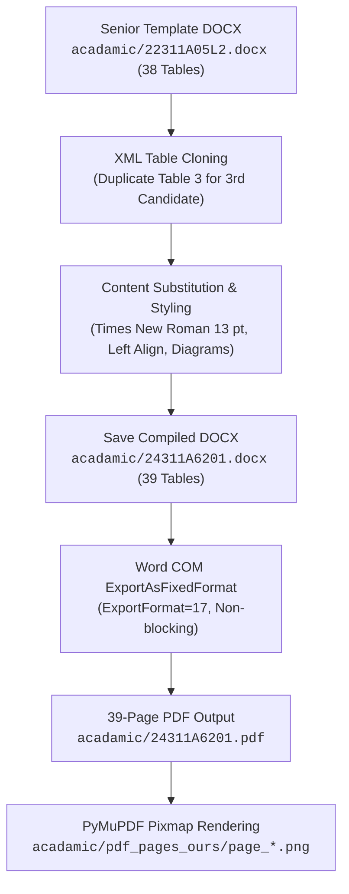

# 🎓 Cyber-Shield: Academic Report Automation Guide

This guide details the engineering principles, layout specifications, and execution instructions for the automated 39-page **Group Internship Report** compiler (`acadamic/generate_report.py`).

---

## 📌 Background & Requirements

The report documents the **Summer Industry Internship – I** undertaken under the **Networking Cloud Virtual Internship** track supported by **EduSkills Foundation** in association with **Juniper Networks** and **Palo Alto Networks**, submitted to the Department of Computer Science and Engineering (Cyber Security) at **Sreenidhi Institute of Science and Technology (SNIST)**.

To meet strict university evaluation standards, the report must conform **1:1** to the senior reference report (`acadamic/22311A05L2.docx` / `acadamic/22311A05L2.pdf`) across all 39 pages.

---

## 👥 Candidate Information & Roll Number Ordering

University guidelines mandate that candidates are listed in strict ascending order of academic roll numbers across all sections (Cover, Declaration, Certificates, Batch details, and Signatures):

1. **24311A6201** – **POOJITHA BURRI**
2. **24311A6203** – **BABY BHAVYA SRI CHOWDARY**
3. **24311A6211** – **ALLE RANAVEER**

---

## 📐 Layout & Formatting Calibration

| Formatting Dimension | Flaw in Initial Drafts | Calibrated Senior Conformance Standard |
|----------------------|------------------------|----------------------------------------|
| **Body Font** | 10.5 pt – 11 pt (under-filled pages) | **Times New Roman 13 pt** throughout body text |
| **Alignment** | Word `JUSTIFY` creating unnatural word gaps | **`WD_ALIGN_PARAGRAPH.LEFT`** with natural spacing |
| **Section Headings** | Number and heading split across lines | Unified on a single bold line (e.g. `1.1 About the Internship`) |
| **Page Numbers** | Floating or offset horizontally | **Centered at the bottom** of each bounding table box with zero indents |
| **Page Filling** | Lower 2–3 inches left empty | Content expanded with technical specifications, filling ~22–26 lines per page |
| **Diagrams & Screens**| Un-captioned or uncentered | Centered with italicized figure captions and 2–3 line analytical notes |
| **Batch & Signature Tables** | Unbordered text or misplaced signatures | All 3 candidates enclosed within formatted table cells with borders |

---

## 🏗️ Technical Architecture of the Report Generator

The generator script (`acadamic/generate_report.py`) utilizes `python-docx`, `win32com.client`, and `PyMuPDF` (`fitz`):



### 1. XML Table Cloning for Candidate 3
The senior template was constructed for a 2-member group (38 total single-cell page tables). Cyber-Shield has 3 members.
- The script clones Table 3 (`doc.tables[3]._tbl`) via `deepcopy`.
- It inserts the cloned table after Table 3 using `target.addprevious(el)`.
- The document expands cleanly to **39 top-level tables**, providing a dedicated individual certificate page for each of the three candidates (Pages 3, 4, and 5).

### 2. Eliminating Justification Word Gaps
Word's default `JUSTIFY` stretches text across margins, creating unsightly white gaps between words. The generator enforces:
```python
p.alignment = WD_ALIGN_PARAGRAPH.LEFT
p.paragraph_format.line_spacing = 1.15
p.paragraph_format.left_indent = Inches(0.4)
p.paragraph_format.right_indent = Inches(0.3)
```

### 3. Deepcopy Table Row Insertion for Page 38 & 39
To avoid unbordered rows when adding Candidate 3 to the Batch and Signatures tables:
```python
# Deepcopy preserves w:tcBorders, w:tcMar, and w:tcW
new_tr = deepcopy(t_batch.rows[3]._tr)
t_batch._tbl.append(new_tr)
```
This guarantees that all 3 candidates remain inside the table grid without external overflow.

### 4. Non-Blocking Word COM PDF Export
Instead of interactive Word dialogs that can hang on modal prompts, the generator calls:
```python
wdoc.ExportAsFixedFormat(
    OutputFileName=abs_pdf,
    ExportFormat=17 # wdExportFormatPDF
)
```
This exports the entire 39-page document cleanly in approximately 6 to 8 seconds.

---

## 🚀 Execution Instructions

To rebuild the report, execute from the repository root:

```powershell
python acadamic/generate_report.py
```

### Console Output
```text
Loading senior template: acadamic/22311A05L2.docx
Total tables after cloning: 39
Saving compiled DOCX to: acadamic/24311A6201.docx
DOCX saved successfully!
Exporting to PDF via Word COM ExportAsFixedFormat: C:\Users\ranua\Videos\Cyber-Guard\acadamic\24311A6201.pdf
PDF export successful!
Total pages in exported PDF: 39
Rendered all 39 pages to acadamic/pdf_pages_ours/
```

---

## 🖼️ Included Diagrams & Output Screens

1. **Architecture Diagram** (`acadamic/report_assets/architecture_diagram.png`) – Page 16
2. **Use Case Diagram** (`acadamic/report_assets/usecase_diagram.png`) – Page 18
3. **Class Diagram** (`acadamic/report_assets/class_diagram.png`) – Page 19
4. **Sequence Diagram** (`acadamic/report_assets/sequence_diagram.png`) – Page 20
5. **Activity Diagram** (`acadamic/report_assets/activity_diagram.png`) – Page 21
6. **8 Dark-Mode SOC Screenshots** (`acadamic/report_assets/add-this-images/`):
   - Executive Dashboard & Real-Time KPIs (Page 27)
   - Live Alerts Triage Queue (Page 27)
   - Deep Threat Analysis & Protocol Breakdown (Page 28)
   - Forensic Shift Summary & Compliance Reporting (Page 28)
   - Declarative Rules Engine & YAML Editor (Page 29)
   - Real-Time Traffic Telemetry & Promiscuous Sniffer (Page 29)
   - Attacker IP Behavioral Profiling & Timeline (Page 30)
   - Ingestion Engine Configuration & Agent Telemetry (Page 30)
